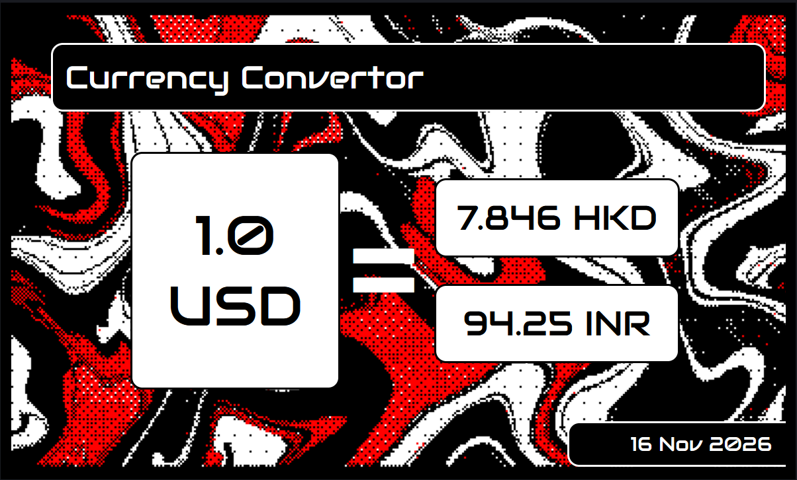

# TMRNL Currency Rates Display

for displaying currency conversion rates from an api for USD, HKD and INR.

> made for [TRMNL BWRY](https://shop.trmnl.com/collections/devices/products/trmnl-bwry)

## Language Used
- liquid
- (html/css/js) as part of liquid

## Screenshot

## Run Locally
1. run `trmnlp serve` in the root directory
2. open `http://127.0.0.1:4567/full` in any browser

## Credits
- made by me
- API Used: [frankfurter dev - v1](https://frankfurter.dev/v1/)
- Bg used: [pinterest](https://in.pinterest.com/pin/1116611302495088013/)
- Dither the bg img: [dither it](https://ditherit.com/?mode=pattern&scale=2&smooth=1&colors=000000-ff0000-ffffff)
- convert bg img to srgb: [brushcue](https://www.brushcue.com/editor?path=localProjects%2FConvert%20to%20sRGB%201)
- cdn to host the image: [hackclub cdn](https://cdn.hackclub.com/)
- custom font: [Audiowide - Google Fonts](https://fonts.google.com/specimen/Audiowide?categoryFilters=Feeling:%2FExpressive%2FFuturistic&preview.script=Latn)
- Design docs for trmnl plugin dev: [by tmrnl](https://help.trmnl.com/en/articles/12410486-framework-design-docs), [trmnl framework docs](https://trmnl.com/framework/docs/3.4)
- to setup trmnlp: [usetrmnl - github](https://github.com/usetrmnl/trmnlp#installing-via-rubygems)
